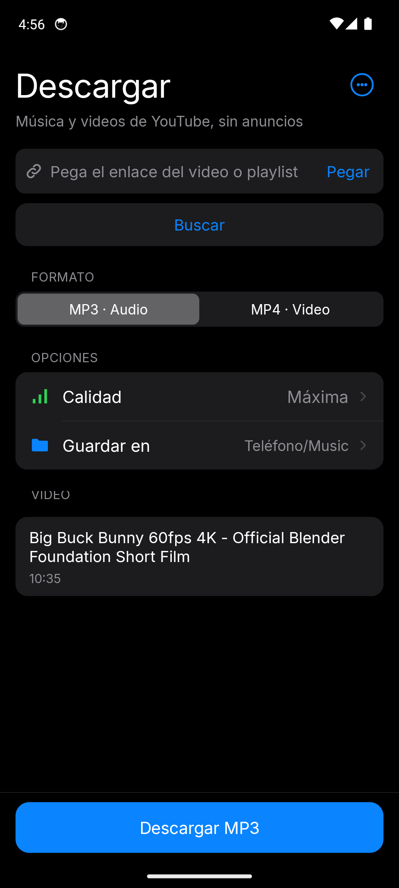
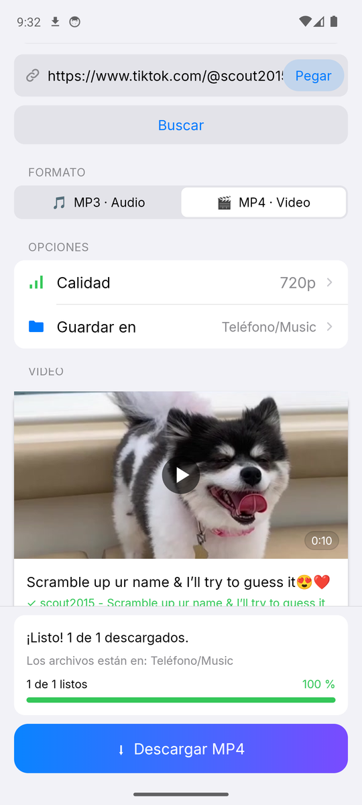
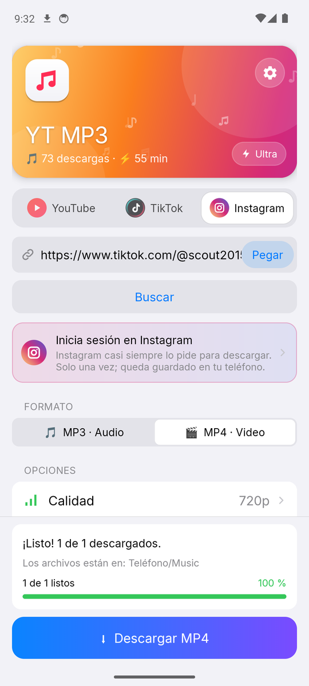
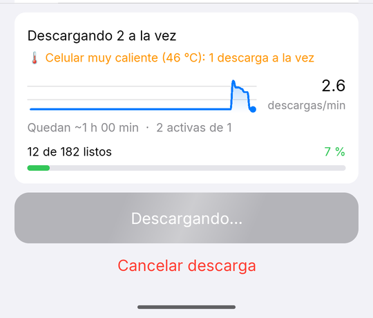
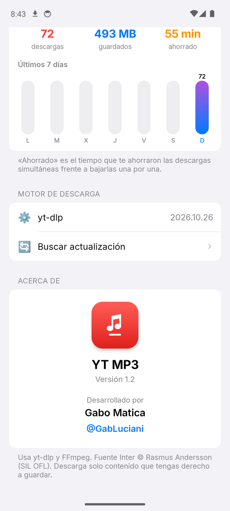
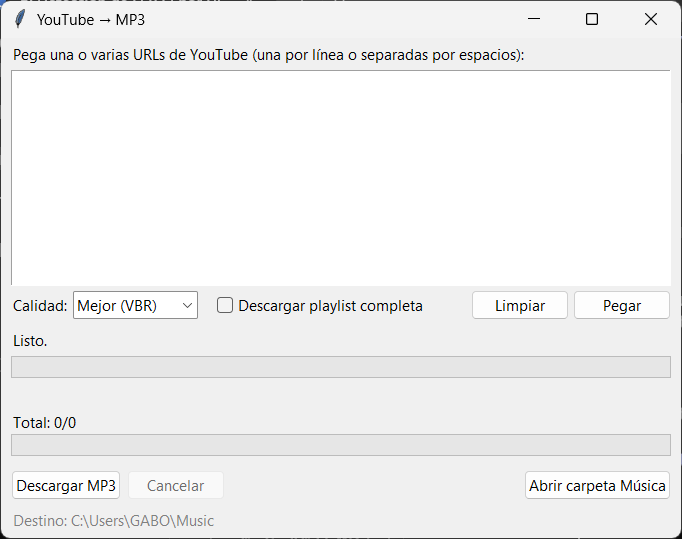

# DownSong (antes MegaDown)

Tu música sin anuncios ni suscripciones: **biblioteca y reproductor** al estilo Spotify, con el descargador integrado.
Descarga música y videos de **YouTube, TikTok, Instagram, Facebook y Spotify** sin anuncios, en Android (y YouTube en Windows).
Por dentro usa [yt-dlp](https://github.com/yt-dlp/yt-dlp) + FFmpeg: todo se procesa en tu equipo, sin pasar por servidores de terceros.

<p align="center">
  
  
  
</p>

## 📲 Descargar la app Android

| APK | Para | Enlace directo |
|---|---|---|
| **arm64** (recomendado) | La mayoría de teléfonos desde 2017 | [DownSong-arm64.apk](https://github.com/superprinx2/YT-MP3/releases/latest/download/DownSong-arm64.apk) |
| armv7 | Teléfonos antiguos de 32 bits | [DownSong-armv7.apk](https://github.com/superprinx2/YT-MP3/releases/latest/download/DownSong-armv7.apk) |
| universal | Cualquier dispositivo (más pesado) | [DownSong-universal.apk](https://github.com/superprinx2/YT-MP3/releases/latest/download/DownSong-universal.apk) |

Ábrelo en el teléfono y acepta **«Instalar apps desconocidas»**. Requiere Android 8.0 o superior.
Todas las versiones están en [Releases](https://github.com/superprinx2/YT-MP3/releases).

## Funciones

- **Biblioteca y playlists**: cada canción se guarda una sola vez; las playlists apuntan a ella. Nombre y portada editables.
- **Reproductor** al estilo Spotify: fondo con el color de la portada, aleatorio, repetir, deslizar para cambiar de canción, video opcional.
- **Segundo plano y pantalla de bloqueo** con anterior, pausa, siguiente, aleatorio y repetir.
- **Crossfade** (1 a 12 s), **nivelar volumen**, temas claro, oscuro, sistema y dinámico.
- **Modo DJ**: elige canciones de ritmo parecido, empieza por el coro y mezcla con efectos; también por estado de ánimo (12 modos) y aprende de ti.
- **Visualizador** hipnótico (OpenGL) y **pantalla de bloqueo propia** con la portada.
- **Ecualizador** con perfiles, **estadísticas** del mes y modos de uso (Máximo, Equilibrado, Ahorro).
- **Caleidoscopio** animado al ritmo de la música para las canciones sin portada.
- **Música del celular**: agrégala a tus playlists sin copiarla.
- **Cinco plataformas** con pestañas: **YouTube**, **TikTok**, **Instagram**, **Facebook** y **Spotify**. Al pegar un enlace la app cambia sola de pestaña.
- **TikTok**: video MP4 **sin marca de agua** o solo el audio en MP3.
- **Instagram**: reels y videos de publicaciones en MP4 o MP3.
- **Facebook**: videos y reels públicos en MP4 o MP3.
- **Spotify**: playlists, álbumes y canciones en MP3. El audio de Spotify está protegido (DRM), así que la app
  lee la lista de canciones y baja cada una desde YouTube, eligiendo la versión cuya duración coincide.
  Spotify muestra hasta 100 canciones por enlace.
- **No hace falta iniciar sesión.** Solo si una plataforma lo exige (o pide «confirma que no eres un robot»),
  la app pausa, te avisa y te deja hacerlo dentro de la app; queda guardado solo en el teléfono.
- Pega un enlace de **video o playlist** (o usa **Compartir → DownSong** desde YouTube, TikTok, Instagram o Facebook).
- **MP3** (audio, con portada y etiquetas) o **MP4** (video H.264), con selección de calidad.
- **Playlists completas**: detecta todos los videos, eliges cuáles con casillas y los baja todos.
- **Modo Ultra ⚡**: varias descargas a la vez según la memoria y núcleos del teléfono (hasta 8).
  En pruebas fue unas **3 veces más rápido** que descargar de una en una.
- **Protección de calor**: si el teléfono se calienta o la batería está baja, baja el ritmo y desactiva Ultra solo.
- **Segundo plano real**: sigue descargando con la pantalla bloqueada.
- **Verificación de YouTube**: si YouTube pide «confirma que no eres un robot», la app pausa, te avisa y
  te deja resolverlo dentro de la app; luego reanuda.
- Actualiza yt-dlp automáticamente y reintenta con otros clientes para evitar errores `HTTP 403`.
- Interfaz estilo iOS con modo claro/oscuro, miniaturas, gráficos de velocidad y estadísticas.

<p align="center">
  
  
</p>

<p align="center">
  
  
</p>

### Compilar

```bash
cd android
./gradlew assembleRelease
```

Para firmar en release crea `android/keystore.properties` (no se incluye en el repo) con `storeFile`, `storePassword`, `keyAlias` y `keyPassword`.

## Windows

<p align="center">
  
</p>

1. Ejecuta `instalar_ytmp3.bat` (instala yt-dlp y FFmpeg con winget).
2. Abre `ytmp3_gui.bat` para la interfaz gráfica, o `ytmp3.bat` para la versión de consola.

Admite varias URLs a la vez, playlists completas y elección de calidad. Los MP3 se guardan en tu carpeta Música.

## Cómo surgió

`ANALISIS_y2mate.md` documenta el análisis de y2mate: resultó ser una fachada de un backend privado lleno de anuncios y popunders. Este proyecto replica lo mismo en local con yt-dlp + FFmpeg.

## Créditos

Desarrollado por **Gabo Matica** · @GabLuciani

## Aviso

Úsalo solo con contenido del que tengas derechos o permiso de descarga, y respeta los Términos de Servicio de YouTube.
Fuente Inter bajo licencia SIL OFL (`android/app/src/main/assets/Inter-LICENSE.txt`).
