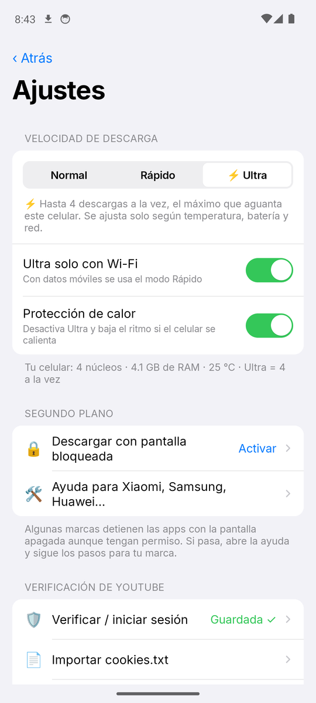

# YT-MP3

Descarga música y videos de YouTube **sin anuncios**, en Android y en Windows.
Por dentro usa [yt-dlp](https://github.com/yt-dlp/yt-dlp) + FFmpeg: todo se procesa en tu equipo, sin pasar por servidores de terceros.

<p align="center">
  
  
  
</p>

## 📲 Descargar la app Android

| APK | Para | Enlace directo |
|---|---|---|
| **arm64** (recomendado) | La mayoría de teléfonos desde 2017 | [YT-MP3-arm64.apk](https://github.com/superprinx2/YT-MP3/releases/latest/download/YT-MP3-arm64.apk) |
| armv7 | Teléfonos antiguos de 32 bits | [YT-MP3-armv7.apk](https://github.com/superprinx2/YT-MP3/releases/latest/download/YT-MP3-armv7.apk) |
| universal | Cualquier dispositivo (más pesado) | [YT-MP3-universal.apk](https://github.com/superprinx2/YT-MP3/releases/latest/download/YT-MP3-universal.apk) |

Ábrelo en el teléfono y acepta **«Instalar apps desconocidas»**. Requiere Android 8.0 o superior.
Todas las versiones están en [Releases](https://github.com/superprinx2/YT-MP3/releases).

## Funciones

- Pega un enlace de **video o playlist** (o usa **Compartir → YT MP3** desde la app de YouTube).
- **MP3** (audio, con portada y etiquetas) o **MP4** (video H.264), con selección de calidad.
- **Playlists completas**: detecta todos los videos, eliges cuáles con casillas y los baja todos.
- **Modo Ultra ⚡**: varias descargas a la vez según la memoria y núcleos del teléfono (hasta 8).
  En pruebas fue unas **3 veces más rápido** que descargar de una en una.
- **Protección de calor**: si el teléfono se calienta o la batería está baja, baja el ritmo y desactiva Ultra solo.
- **Segundo plano real**: sigue descargando con la pantalla bloqueada.
- **Verificación de YouTube**: si YouTube pide «confirma que no eres un robot», la app pausa, te avisa y
  te deja resolverlo dentro de la app; luego reanuda.
- Actualiza yt-dlp automáticamente y reintenta con otros clientes para evitar errores `HTTP 403`.
- Interfaz estilo iOS con modo claro/oscuro, miniaturas, gráficos de velocidad y estadísticas.

<p align="center">
  
  
</p>

### Compilar

```bash
cd android
./gradlew assembleRelease
```

Para firmar en release crea `android/keystore.properties` (no se incluye en el repo) con `storeFile`, `storePassword`, `keyAlias` y `keyPassword`.

## Windows

<p align="center">
  
</p>

1. Ejecuta `instalar_ytmp3.bat` (instala yt-dlp y FFmpeg con winget).
2. Abre `ytmp3_gui.bat` para la interfaz gráfica, o `ytmp3.bat` para la versión de consola.

Admite varias URLs a la vez, playlists completas y elección de calidad. Los MP3 se guardan en tu carpeta Música.

## Cómo surgió

`ANALISIS_y2mate.md` documenta el análisis de y2mate: resultó ser una fachada de un backend privado lleno de anuncios y popunders. Este proyecto replica lo mismo en local con yt-dlp + FFmpeg.

## Créditos

Desarrollado por **Gabo Matica** · @GabLuciani

## Aviso

Úsalo solo con contenido del que tengas derechos o permiso de descarga, y respeta los Términos de Servicio de YouTube.
Fuente Inter bajo licencia SIL OFL (`android/app/src/main/assets/Inter-LICENSE.txt`).
