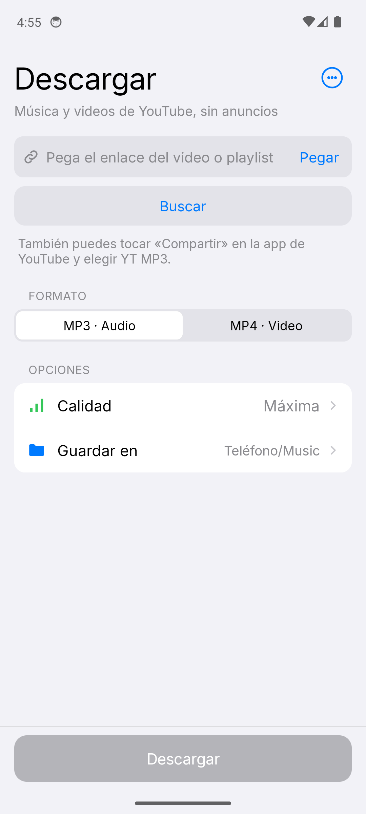
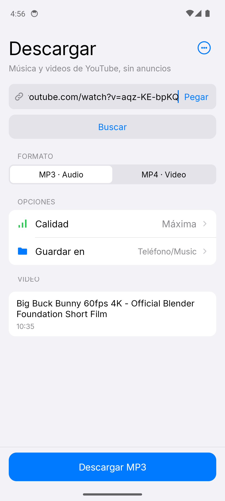

# YT-MP3

Descarga música y videos de YouTube **sin anuncios**, en Android y en Windows.
Por dentro usa [yt-dlp](https://github.com/yt-dlp/yt-dlp) + FFmpeg: todo se procesa en tu equipo, sin pasar por servidores de terceros.

<p align="center">
  
  
  
</p>

## App Android

- Pega un enlace de video o playlist (o usa **Compartir → YT MP3** desde la app de YouTube).
- Formato **MP3 (audio)** o **MP4 (video)**, con selección de calidad.
- Elige la carpeta de destino (por defecto `Music`).
- Descargas en segundo plano con notificación de progreso.
- Actualiza yt-dlp automáticamente para evitar errores `HTTP 403`.
- Interfaz estilo iOS con modo claro/oscuro.

**Descarga:** ve a [Releases](../../releases) e instala el APK de tu dispositivo:

| APK | Para |
|---|---|
| `YT-MP3-1.1-arm64.apk` | La mayoría de teléfonos modernos |
| `YT-MP3-1.1-armv7.apk` | Teléfonos antiguos de 32 bits |
| `YT-MP3-1.1-universal.apk` | Cualquier dispositivo (más pesado) |

Requiere Android 8.0 o superior.

### Compilar

```bash
cd android
./gradlew assembleRelease
```

Para firmar en release crea `android/keystore.properties` (no se incluye en el repo) con `storeFile`, `storePassword`, `keyAlias` y `keyPassword`.

## Windows

<p align="center">
  
</p>

1. Ejecuta `instalar_ytmp3.bat` (instala yt-dlp y FFmpeg con winget).
2. Abre `ytmp3_gui.bat` para la interfaz gráfica, o `ytmp3.bat` para la versión de consola.

Admite varias URLs a la vez, playlists completas y elección de calidad. Los MP3 se guardan en tu carpeta Música.

## Cómo surgió

`ANALISIS_y2mate.md` documenta el análisis de y2mate: resultó ser una fachada de un backend privado lleno de anuncios y popunders. Este proyecto replica lo mismo en local con yt-dlp + FFmpeg.

## Aviso

Úsalo solo con contenido del que tengas derechos o permiso de descarga, y respeta los Términos de Servicio de YouTube.
Fuente Inter bajo licencia SIL OFL (`android/app/src/main/assets/Inter-LICENSE.txt`).
